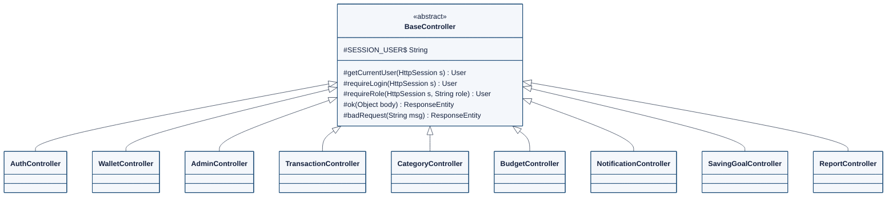
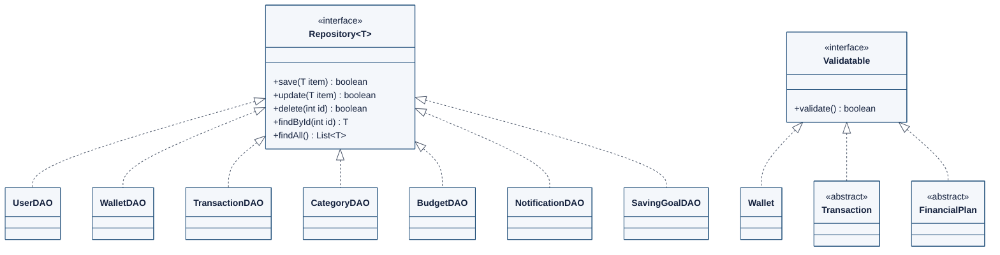
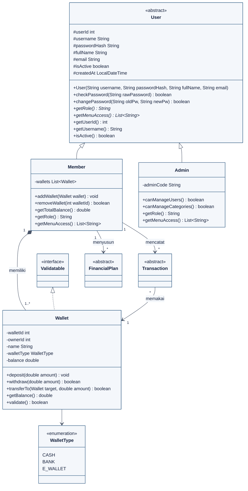
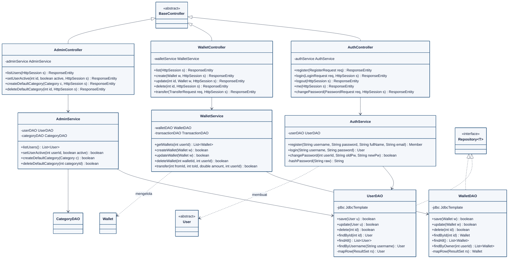
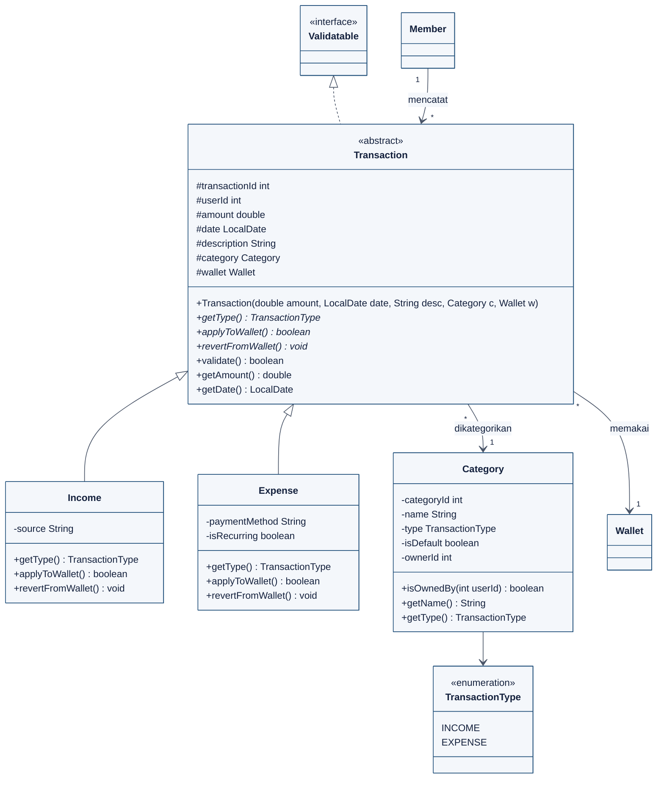
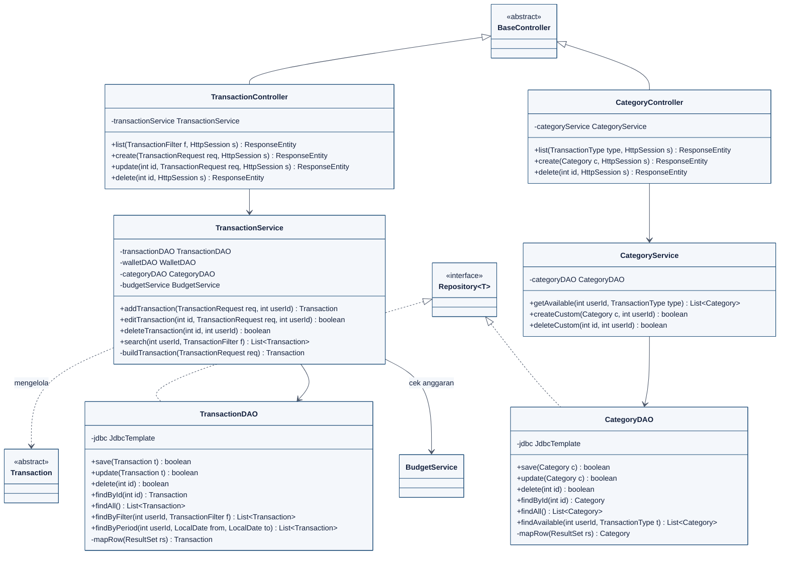
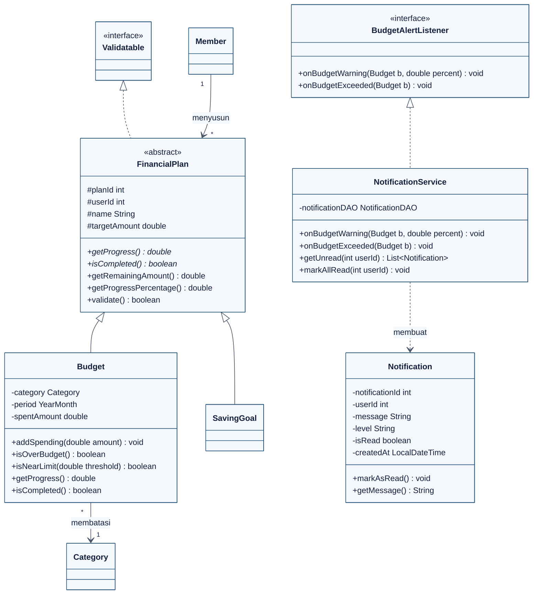
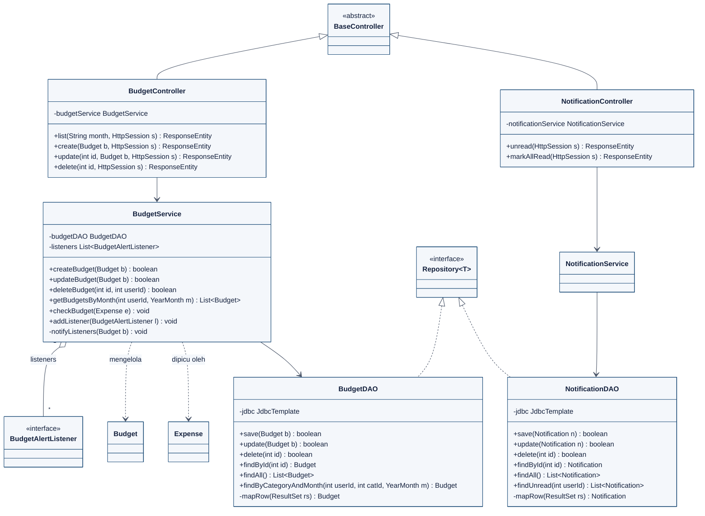
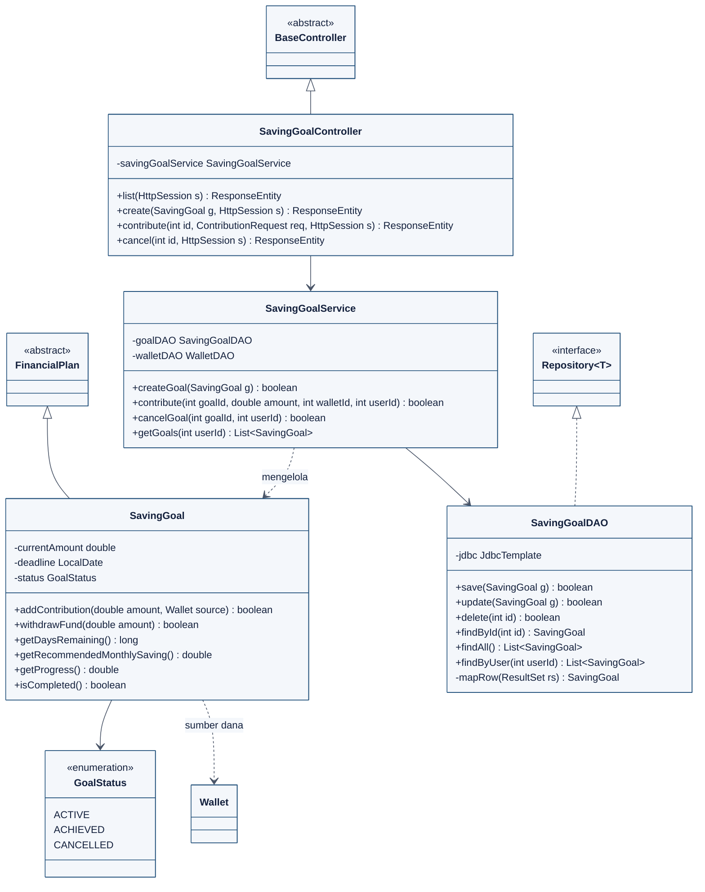
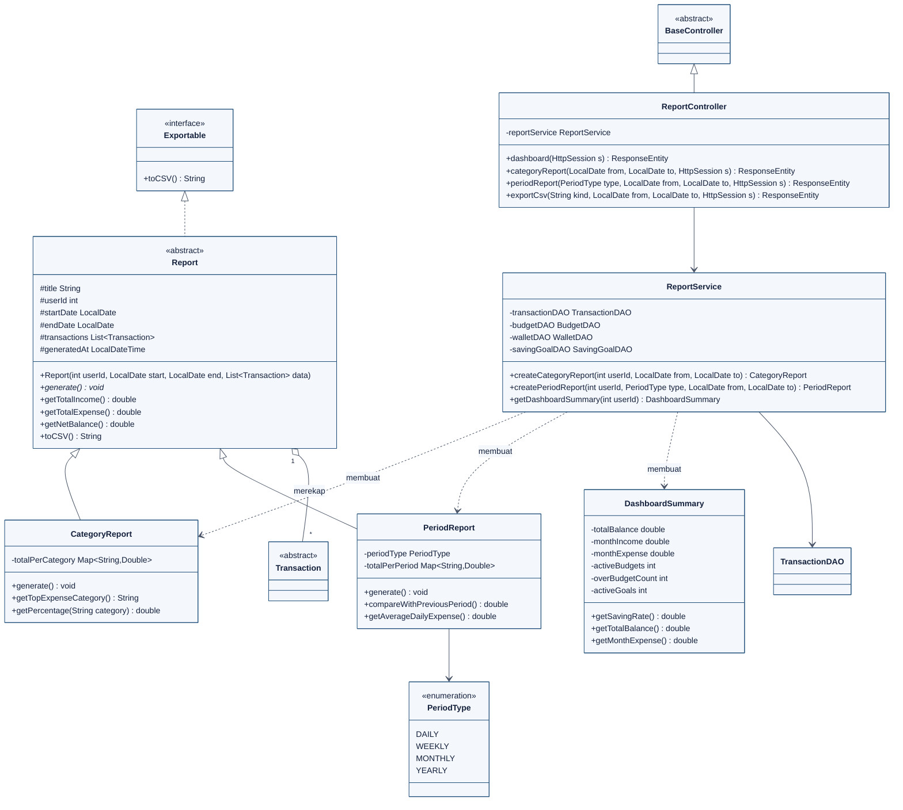

# Spesifikasi Kelas (Class Design) SpendWise

Dokumen ini adalah **sumber kebenaran desain OOP**. Nama kelas, atribut, method, tipe, dan access modifier di kode **harus sama** dengan dokumen ini (yang juga sama dengan class diagram di proposal). Dokumen ini dibuat otomatis dari model class diagram, jadi isinya konsisten 1:1 dengan gambar diagram.

**Aturan:**
1. Jangan mengganti nama/signature method yang tercantum. Jika perlu berubah → ubah dokumen ini lewat PR dan perbarui class diagram untuk laporan akhir.
2. Boleh menambah method `private` pembantu tanpa izin (mis. `formatMonth()`), selama tidak mengubah kontrak public.
3. Getter/setter sederhana tidak dicantumkan semua di diagram; buat sesuai kebutuhan **kecuali** `setBalance()` (dilarang, BR-01).
4. Method tambahan yang sudah disepakati tercantum di **§7** — wajib dimasukkan ke class diagram versi laporan akhir.

## Daftar Isi
1. [Ringkasan Kelas per Anggota](#1-ringkasan-kelas-per-anggota)
2. [Core (Bersama)](#2-core-bersama)
3. [Modul 1 — Akun & Dompet](#3-modul-1--akun--dompet-anggota-1)
4. [Modul 2 — Transaksi & Kategori](#4-modul-2--transaksi--kategori-anggota-2)
5. [Modul 3 — Anggaran & Tabungan](#5-modul-3--anggaran--tabungan-anggota-3)
6. [Modul 4 — Laporan & Dashboard](#6-modul-4--laporan--dashboard-anggota-4)
7. [Method Tambahan yang Disepakati](#7-method-tambahan-yang-disepakati)
8. [Catatan Implementasi Penting](#8-catatan-implementasi-penting)

---

## 1. Ringkasan Kelas per Anggota

| Modul | PJ | Model | Controller | Service | DAO | Jumlah |
|---|---|---|---|---|---|---|
| Core | Semua | Repository<T>, Validatable, BaseController | — | — | — | 3 |
| Modul 1 — Akun & Dompet | Anggota 1 | User, Member, Admin, Wallet, WalletType | AuthController, WalletController, AdminController | AuthService, WalletService, AdminService | UserDAO, WalletDAO | 13 |
| Modul 2 — Transaksi & Kategori | Anggota 2 | Transaction, Income, Expense, Category, TransactionType | TransactionController, CategoryController | TransactionService, CategoryService | TransactionDAO, CategoryDAO | 11 |
| Modul 3 — Anggaran & Tabungan | Anggota 3 | FinancialPlan, Budget, SavingGoal, GoalStatus, BudgetAlertListener, Notification | BudgetController, NotificationController, SavingGoalController | NotificationService, BudgetService, SavingGoalService | BudgetDAO, NotificationDAO, SavingGoalDAO | 15 |
| Modul 4 — Laporan & Dashboard | Anggota 4 | Exportable, Report, CategoryReport, PeriodReport, PeriodType, DashboardSummary | ReportController | ReportService | — | 8 |

**Total: 50 tipe** (kelas, abstract class, interface, enum).

| Konsep wajib | Bukti di desain |
|---|---|
| Inheritance | `User`→`Member`,`Admin` · `Transaction`→`Income`,`Expense` · `FinancialPlan`→`Budget`,`SavingGoal` · `Report`→`CategoryReport`,`PeriodReport` · `BaseController`→9 controller |
| Abstract class | `BaseController`, `User`, `Transaction`, `FinancialPlan`, `Report` |
| Interface | `Repository<T>`, `Validatable`, `BudgetAlertListener`, `Exportable` |

**Notasi tabel:** kolom *Modifier* memakai keyword Java. `abstract` = method abstrak (wajib dioverride subclass).

---

## 2. Core (Bersama)

<details><summary>Source Mermaid diagram <code>core_ctrl</code> (klik untuk membuka)</summary>


</details>

<details><summary>Source Mermaid diagram <code>core_repo</code> (klik untuk membuka)</summary>


</details>

### 2.1 `Repository<T>`  
*package* `com.spendwise.core`

```java
public interface Repository<T>
```

Kontrak CRUD generik. Di-implement oleh semua DAO.

| Modifier | Method | Return |
|---|---|---|
| `public` | `save(T item)` | `boolean` |
| `public` | `update(T item)` | `boolean` |
| `public` | `delete(int id)` | `boolean` |
| `public` | `findById(int id)` | `T` |
| `public` | `findAll()` | `List<T>` |

### 2.2 `Validatable`  
*package* `com.spendwise.core`

```java
public interface Validatable
```

Kontrak validasi objek sebelum disimpan. `validate()` mengembalikan `true` jika valid, dan **melempar `BusinessException`** berisi pesan yang jelas jika tidak.

| Modifier | Method | Return |
|---|---|---|
| `public` | `validate()` | `boolean` |

### 2.3 `BaseController`  
*package* `com.spendwise.core`

```java
public abstract class BaseController
```

Superclass semua controller. Menyediakan pengambilan user dari session, pengecekan login/role, dan pembungkus respons `ApiResponse`.

| Modifier | Atribut | Tipe |
|---|---|---|
| `protected static` | `SESSION_USER` | `String` |

| Modifier | Method | Return |
|---|---|---|
| `protected` | `getCurrentUser(HttpSession s)` | `User` |
| `protected` | `requireLogin(HttpSession s)` | `User` |
| `protected` | `requireRole(HttpSession s, String role)` | `User` |
| `protected` | `ok(Object body)` | `ResponseEntity` |
| `protected` | `badRequest(String msg)` | `ResponseEntity` |

---

## 3. Modul 1 — Akun & Dompet (Anggota 1)

<details><summary>Source Mermaid diagram <code>m1a</code> (klik untuk membuka)</summary>


</details>

<details><summary>Source Mermaid diagram <code>m1b</code> (klik untuk membuka)</summary>


</details>

### 3.1 `User`  
*package* `com.spendwise.model`

```java
public abstract class User
```

Superclass pengguna. `getRole()` dan `getMenuAccess()` abstrak → dioverride `Member` dan `Admin` (polymorphism).

| Modifier | Atribut | Tipe |
|---|---|---|
| `protected` | `userId` | `int` |
| `protected` | `username` | `String` |
| `protected` | `passwordHash` | `String` |
| `protected` | `fullName` | `String` |
| `protected` | `email` | `String` |
| `protected` | `isActive` | `boolean` |
| `protected` | `createdAt` | `LocalDateTime` |

| Modifier | Method | Return |
|---|---|---|
| `public` | `User(String username, String passwordHash, String fullName, String email)` | `—` |
| `public` | `checkPassword(String rawPassword)` | `boolean` |
| `public` | `changePassword(String oldPw, String newPw)` | `boolean` |
| `public abstract` | `getRole()` | `String` |
| `public abstract` | `getMenuAccess()` | `List<String>` |
| `public` | `getUserId()` | `int` |
| `public` | `getUsername()` | `String` |
| `public` | `isActive()` | `boolean` |

### 3.2 `Member`  
*package* `com.spendwise.model`

```java
public class Member extends User
```

Pengguna biasa. Memiliki (komposisi) satu atau lebih `Wallet`.

| Modifier | Atribut | Tipe |
|---|---|---|
| `private` | `wallets` | `List<Wallet>` |

| Modifier | Method | Return |
|---|---|---|
| `public` | `addWallet(Wallet wallet)` | `void` |
| `public` | `removeWallet(int walletId)` | `boolean` |
| `public` | `getTotalBalance()` | `double` |
| `public` | `getRole()` | `String` |
| `public` | `getMenuAccess()` | `List<String>` |

### 3.3 `Admin`  
*package* `com.spendwise.model`

```java
public class Admin extends User
```

Pengelola sistem. Tidak memiliki dompet/transaksi.

| Modifier | Atribut | Tipe |
|---|---|---|
| `private` | `adminCode` | `String` |

| Modifier | Method | Return |
|---|---|---|
| `public` | `canManageUsers()` | `boolean` |
| `public` | `canManageCategories()` | `boolean` |
| `public` | `getRole()` | `String` |
| `public` | `getMenuAccess()` | `List<String>` |

### 3.4 `Wallet`  
*package* `com.spendwise.model`

```java
public class Wallet implements Validatable
```

Dompet. **Tidak ada setter `balance`** — saldo hanya berubah lewat `deposit`, `withdraw`, `transferTo` (BR-01, BR-02).

| Modifier | Atribut | Tipe |
|---|---|---|
| `private` | `walletId` | `int` |
| `private` | `ownerId` | `int` |
| `private` | `name` | `String` |
| `private` | `walletType` | `WalletType` |
| `private` | `balance` | `double` |

| Modifier | Method | Return |
|---|---|---|
| `public` | `deposit(double amount)` | `void` |
| `public` | `withdraw(double amount)` | `boolean` |
| `public` | `transferTo(Wallet target, double amount)` | `boolean` |
| `public` | `getBalance()` | `double` |
| `public` | `validate()` | `boolean` |

### 3.5 `WalletType`  
*package* `com.spendwise.model`

```java
public enum WalletType
```

Jenis dompet.

Nilai: `CASH`, `BANK`, `E_WALLET`

### 3.6 `AuthController`  
*package* `com.spendwise.controller`

```java
public class AuthController extends BaseController
```

Endpoint `/api/auth/**`.

| Modifier | Atribut | Tipe |
|---|---|---|
| `private` | `authService` | `AuthService` |

| Modifier | Method | Return |
|---|---|---|
| `public` | `register(RegisterRequest req)` | `ResponseEntity` |
| `public` | `login(LoginRequest req, HttpSession s)` | `ResponseEntity` |
| `public` | `logout(HttpSession s)` | `ResponseEntity` |
| `public` | `me(HttpSession s)` | `ResponseEntity` |
| `public` | `changePassword(PasswordRequest req, HttpSession s)` | `ResponseEntity` |

### 3.7 `WalletController`  
*package* `com.spendwise.controller`

```java
public class WalletController extends BaseController
```

Endpoint `/api/wallets/**`.

| Modifier | Atribut | Tipe |
|---|---|---|
| `private` | `walletService` | `WalletService` |

| Modifier | Method | Return |
|---|---|---|
| `public` | `list(HttpSession s)` | `ResponseEntity` |
| `public` | `create(Wallet w, HttpSession s)` | `ResponseEntity` |
| `public` | `update(int id, Wallet w, HttpSession s)` | `ResponseEntity` |
| `public` | `delete(int id, HttpSession s)` | `ResponseEntity` |
| `public` | `transfer(TransferRequest req, HttpSession s)` | `ResponseEntity` |

### 3.8 `AdminController`  
*package* `com.spendwise.controller`

```java
public class AdminController extends BaseController
```

Endpoint `/api/admin/**`. Setiap method memanggil `requireRole(s, "ADMIN")`.

| Modifier | Atribut | Tipe |
|---|---|---|
| `private` | `adminService` | `AdminService` |

| Modifier | Method | Return |
|---|---|---|
| `public` | `listUsers(HttpSession s)` | `ResponseEntity` |
| `public` | `setUserActive(int id, boolean active, HttpSession s)` | `ResponseEntity` |
| `public` | `createDefaultCategory(Category c, HttpSession s)` | `ResponseEntity` |
| `public` | `deleteDefaultCategory(int id, HttpSession s)` | `ResponseEntity` |

### 3.9 `AuthService`  
*package* `com.spendwise.service`

```java
public class AuthService
```

Registrasi, login, ganti password, hashing (format `salt$sha256hex`).

| Modifier | Atribut | Tipe |
|---|---|---|
| `private` | `userDAO` | `UserDAO` |

| Modifier | Method | Return |
|---|---|---|
| `public` | `register(String username, String password, String fullName, String email)` | `Member` |
| `public` | `login(String username, String password)` | `User` |
| `public` | `changePassword(int userId, String oldPw, String newPw)` | `boolean` |
| `private` | `hashPassword(String raw)` | `String` |

### 3.10 `WalletService`  
*package* `com.spendwise.service`

```java
public class WalletService
```

CRUD dompet dan transfer antar dompet (`@Transactional`).

| Modifier | Atribut | Tipe |
|---|---|---|
| `private` | `walletDAO` | `WalletDAO` |
| `private` | `transactionDAO` | `TransactionDAO` |

| Modifier | Method | Return |
|---|---|---|
| `public` | `getWallets(int userId)` | `List<Wallet>` |
| `public` | `createWallet(Wallet w)` | `boolean` |
| `public` | `updateWallet(Wallet w)` | `boolean` |
| `public` | `deleteWallet(int walletId, int userId)` | `boolean` |
| `public` | `transfer(int fromId, int toId, double amount, int userId)` | `boolean` |

### 3.11 `AdminService`  
*package* `com.spendwise.service`

```java
public class AdminService
```

Aktivasi pengguna dan kategori default.

| Modifier | Atribut | Tipe |
|---|---|---|
| `private` | `userDAO` | `UserDAO` |
| `private` | `categoryDAO` | `CategoryDAO` |

| Modifier | Method | Return |
|---|---|---|
| `public` | `listUsers()` | `List<User>` |
| `public` | `setUserActive(int userId, boolean active)` | `boolean` |
| `public` | `createDefaultCategory(Category c)` | `boolean` |
| `public` | `deleteDefaultCategory(int categoryId)` | `boolean` |

### 3.12 `UserDAO`  
*package* `com.spendwise.dao`

```java
public class UserDAO implements Repository<User>
```

Tabel `users`. `mapRow` membuat `Member` atau `Admin` berdasarkan kolom `role`.

| Modifier | Atribut | Tipe |
|---|---|---|
| `private` | `jdbc` | `JdbcTemplate` |

| Modifier | Method | Return |
|---|---|---|
| `public` | `save(User u)` | `boolean` |
| `public` | `update(User u)` | `boolean` |
| `public` | `delete(int id)` | `boolean` |
| `public` | `findById(int id)` | `User` |
| `public` | `findAll()` | `List<User>` |
| `public` | `findByUsername(String username)` | `User` |
| `private` | `mapRow(ResultSet rs)` | `User` |

### 3.13 `WalletDAO`  
*package* `com.spendwise.dao`

```java
public class WalletDAO implements Repository<Wallet>
```

Tabel `wallets`.

| Modifier | Atribut | Tipe |
|---|---|---|
| `private` | `jdbc` | `JdbcTemplate` |

| Modifier | Method | Return |
|---|---|---|
| `public` | `save(Wallet w)` | `boolean` |
| `public` | `update(Wallet w)` | `boolean` |
| `public` | `delete(int id)` | `boolean` |
| `public` | `findById(int id)` | `Wallet` |
| `public` | `findAll()` | `List<Wallet>` |
| `public` | `findByOwner(int userId)` | `List<Wallet>` |
| `private` | `mapRow(ResultSet rs)` | `Wallet` |

---

## 4. Modul 2 — Transaksi & Kategori (Anggota 2)

<details><summary>Source Mermaid diagram <code>m2a</code> (klik untuk membuka)</summary>


</details>

<details><summary>Source Mermaid diagram <code>m2b</code> (klik untuk membuka)</summary>


</details>

### 4.1 `Transaction`  
*package* `com.spendwise.model`

```java
public abstract class Transaction implements Validatable
```

Superclass transaksi. `applyToWallet()`/`revertFromWallet()` abstrak → perilaku berbeda di `Income` dan `Expense`.

| Modifier | Atribut | Tipe |
|---|---|---|
| `protected` | `transactionId` | `int` |
| `protected` | `userId` | `int` |
| `protected` | `amount` | `double` |
| `protected` | `date` | `LocalDate` |
| `protected` | `description` | `String` |
| `protected` | `category` | `Category` |
| `protected` | `wallet` | `Wallet` |

| Modifier | Method | Return |
|---|---|---|
| `public` | `Transaction(double amount, LocalDate date, String desc, Category c, Wallet w)` | `—` |
| `public abstract` | `getType()` | `TransactionType` |
| `public abstract` | `applyToWallet()` | `boolean` |
| `public abstract` | `revertFromWallet()` | `void` |
| `public` | `validate()` | `boolean` |
| `public` | `getAmount()` | `double` |
| `public` | `getDate()` | `LocalDate` |

### 4.2 `Income`  
*package* `com.spendwise.model`

```java
public class Income extends Transaction
```

Pemasukan: `applyToWallet()` → `wallet.deposit(amount)`; `revertFromWallet()` → `wallet.withdraw(amount)`.

| Modifier | Atribut | Tipe |
|---|---|---|
| `private` | `source` | `String` |

| Modifier | Method | Return |
|---|---|---|
| `public` | `getType()` | `TransactionType` |
| `public` | `applyToWallet()` | `boolean` |
| `public` | `revertFromWallet()` | `void` |

### 4.3 `Expense`  
*package* `com.spendwise.model`

```java
public class Expense extends Transaction
```

Pengeluaran: `applyToWallet()` → `wallet.withdraw(amount)` (false jika saldo kurang); `revertFromWallet()` → `wallet.deposit(amount)`.

| Modifier | Atribut | Tipe |
|---|---|---|
| `private` | `paymentMethod` | `String` |
| `private` | `isRecurring` | `boolean` |

| Modifier | Method | Return |
|---|---|---|
| `public` | `getType()` | `TransactionType` |
| `public` | `applyToWallet()` | `boolean` |
| `public` | `revertFromWallet()` | `void` |

### 4.4 `Category`  
*package* `com.spendwise.model`

```java
public class Category
```

Kategori transaksi; default (milik sistem) atau kustom (milik member).

| Modifier | Atribut | Tipe |
|---|---|---|
| `private` | `categoryId` | `int` |
| `private` | `name` | `String` |
| `private` | `type` | `TransactionType` |
| `private` | `isDefault` | `boolean` |
| `private` | `ownerId` | `int` |

| Modifier | Method | Return |
|---|---|---|
| `public` | `isOwnedBy(int userId)` | `boolean` |
| `public` | `getName()` | `String` |
| `public` | `getType()` | `TransactionType` |

### 4.5 `TransactionType`  
*package* `com.spendwise.model`

```java
public enum TransactionType
```

Jenis transaksi.

Nilai: `INCOME`, `EXPENSE`

### 4.6 `TransactionController`  
*package* `com.spendwise.controller`

```java
public class TransactionController extends BaseController
```

Endpoint `/api/transactions/**`.

| Modifier | Atribut | Tipe |
|---|---|---|
| `private` | `transactionService` | `TransactionService` |

| Modifier | Method | Return |
|---|---|---|
| `public` | `list(TransactionFilter f, HttpSession s)` | `ResponseEntity` |
| `public` | `create(TransactionRequest req, HttpSession s)` | `ResponseEntity` |
| `public` | `update(int id, TransactionRequest req, HttpSession s)` | `ResponseEntity` |
| `public` | `delete(int id, HttpSession s)` | `ResponseEntity` |

### 4.7 `CategoryController`  
*package* `com.spendwise.controller`

```java
public class CategoryController extends BaseController
```

Endpoint `/api/categories/**`.

| Modifier | Atribut | Tipe |
|---|---|---|
| `private` | `categoryService` | `CategoryService` |

| Modifier | Method | Return |
|---|---|---|
| `public` | `list(TransactionType type, HttpSession s)` | `ResponseEntity` |
| `public` | `create(Category c, HttpSession s)` | `ResponseEntity` |
| `public` | `delete(int id, HttpSession s)` | `ResponseEntity` |

### 4.8 `TransactionService`  
*package* `com.spendwise.service`

```java
public class TransactionService
```

Inti modul 2. Membangun `Income`/`Expense` dari request, menerapkan ke saldo, menyimpan, lalu memanggil `BudgetService`.

| Modifier | Atribut | Tipe |
|---|---|---|
| `private` | `transactionDAO` | `TransactionDAO` |
| `private` | `walletDAO` | `WalletDAO` |
| `private` | `categoryDAO` | `CategoryDAO` |
| `private` | `budgetService` | `BudgetService` |

| Modifier | Method | Return |
|---|---|---|
| `public` | `addTransaction(TransactionRequest req, int userId)` | `Transaction` |
| `public` | `editTransaction(int id, TransactionRequest req, int userId)` | `boolean` |
| `public` | `deleteTransaction(int id, int userId)` | `boolean` |
| `public` | `search(int userId, TransactionFilter f)` | `List<Transaction>` |
| `private` | `buildTransaction(TransactionRequest req)` | `Transaction` |

### 4.9 `CategoryService`  
*package* `com.spendwise.service`

```java
public class CategoryService
```

Kategori tersedia untuk member dan kategori kustom.

| Modifier | Atribut | Tipe |
|---|---|---|
| `private` | `categoryDAO` | `CategoryDAO` |

| Modifier | Method | Return |
|---|---|---|
| `public` | `getAvailable(int userId, TransactionType type)` | `List<Category>` |
| `public` | `createCustom(Category c, int userId)` | `boolean` |
| `public` | `deleteCustom(int id, int userId)` | `boolean` |

### 4.10 `TransactionDAO`  
*package* `com.spendwise.dao`

```java
public class TransactionDAO implements Repository<Transaction>
```

Tabel `transactions`. `mapRow` membuat `Income` atau `Expense` berdasarkan kolom `type`.

| Modifier | Atribut | Tipe |
|---|---|---|
| `private` | `jdbc` | `JdbcTemplate` |

| Modifier | Method | Return |
|---|---|---|
| `public` | `save(Transaction t)` | `boolean` |
| `public` | `update(Transaction t)` | `boolean` |
| `public` | `delete(int id)` | `boolean` |
| `public` | `findById(int id)` | `Transaction` |
| `public` | `findAll()` | `List<Transaction>` |
| `public` | `findByFilter(int userId, TransactionFilter f)` | `List<Transaction>` |
| `public` | `findByPeriod(int userId, LocalDate from, LocalDate to)` | `List<Transaction>` |
| `private` | `mapRow(ResultSet rs)` | `Transaction` |

### 4.11 `CategoryDAO`  
*package* `com.spendwise.dao`

```java
public class CategoryDAO implements Repository<Category>
```

Tabel `categories`.

| Modifier | Atribut | Tipe |
|---|---|---|
| `private` | `jdbc` | `JdbcTemplate` |

| Modifier | Method | Return |
|---|---|---|
| `public` | `save(Category c)` | `boolean` |
| `public` | `update(Category c)` | `boolean` |
| `public` | `delete(int id)` | `boolean` |
| `public` | `findById(int id)` | `Category` |
| `public` | `findAll()` | `List<Category>` |
| `public` | `findAvailable(int userId, TransactionType t)` | `List<Category>` |
| `private` | `mapRow(ResultSet rs)` | `Category` |

---

## 5. Modul 3 — Anggaran & Tabungan (Anggota 3)

<details><summary>Source Mermaid diagram <code>m3a</code> (klik untuk membuka)</summary>


</details>

<details><summary>Source Mermaid diagram <code>m3b</code> (klik untuk membuka)</summary>


</details>

<details><summary>Source Mermaid diagram <code>m3c</code> (klik untuk membuka)</summary>


</details>

### 5.1 `FinancialPlan`  
*package* `com.spendwise.model`

```java
public abstract class FinancialPlan implements Validatable
```

Superclass rencana keuangan. `getProgress()` dan `isCompleted()` abstrak.

| Modifier | Atribut | Tipe |
|---|---|---|
| `protected` | `planId` | `int` |
| `protected` | `userId` | `int` |
| `protected` | `name` | `String` |
| `protected` | `targetAmount` | `double` |

| Modifier | Method | Return |
|---|---|---|
| `public abstract` | `getProgress()` | `double` |
| `public abstract` | `isCompleted()` | `boolean` |
| `public` | `getRemainingAmount()` | `double` |
| `public` | `getProgressPercentage()` | `double` |
| `public` | `validate()` | `boolean` |

### 5.2 `Budget`  
*package* `com.spendwise.model`

```java
public class Budget extends FinancialPlan
```

Anggaran satu kategori pengeluaran per bulan. `targetAmount` = batas anggaran.

| Modifier | Atribut | Tipe |
|---|---|---|
| `private` | `category` | `Category` |
| `private` | `period` | `YearMonth` |
| `private` | `spentAmount` | `double` |

| Modifier | Method | Return |
|---|---|---|
| `public` | `addSpending(double amount)` | `void` |
| `public` | `isOverBudget()` | `boolean` |
| `public` | `isNearLimit(double threshold)` | `boolean` |
| `public` | `getProgress()` | `double` |
| `public` | `isCompleted()` | `boolean` |

### 5.3 `SavingGoal`  
*package* `com.spendwise.model`

```java
public class SavingGoal extends FinancialPlan
```

Target tabungan. `targetAmount` = nominal target.

| Modifier | Atribut | Tipe |
|---|---|---|
| `private` | `currentAmount` | `double` |
| `private` | `deadline` | `LocalDate` |
| `private` | `status` | `GoalStatus` |

| Modifier | Method | Return |
|---|---|---|
| `public` | `addContribution(double amount, Wallet source)` | `boolean` |
| `public` | `withdrawFund(double amount)` | `boolean` |
| `public` | `getDaysRemaining()` | `long` |
| `public` | `getRecommendedMonthlySaving()` | `double` |
| `public` | `getProgress()` | `double` |
| `public` | `isCompleted()` | `boolean` |

### 5.4 `GoalStatus`  
*package* `com.spendwise.model`

```java
public enum GoalStatus
```

Status target tabungan.

Nilai: `ACTIVE`, `ACHIEVED`, `CANCELLED`

### 5.5 `BudgetAlertListener`  
*package* `com.spendwise.model`

```java
public interface BudgetAlertListener
```

Observer untuk peristiwa anggaran.

| Modifier | Method | Return |
|---|---|---|
| `public` | `onBudgetWarning(Budget b, double percent)` | `void` |
| `public` | `onBudgetExceeded(Budget b)` | `void` |

### 5.6 `Notification`  
*package* `com.spendwise.model`

```java
public class Notification
```

Notifikasi untuk satu pengguna. `level`: `WARNING` | `DANGER`.

| Modifier | Atribut | Tipe |
|---|---|---|
| `private` | `notificationId` | `int` |
| `private` | `userId` | `int` |
| `private` | `message` | `String` |
| `private` | `level` | `String` |
| `private` | `isRead` | `boolean` |
| `private` | `createdAt` | `LocalDateTime` |

| Modifier | Method | Return |
|---|---|---|
| `public` | `markAsRead()` | `void` |
| `public` | `getMessage()` | `String` |

### 5.7 `NotificationService`  
*package* `com.spendwise.service`

```java
public class NotificationService implements BudgetAlertListener
```

Implementasi `BudgetAlertListener`: membuat dan menyimpan `Notification`.

| Modifier | Atribut | Tipe |
|---|---|---|
| `private` | `notificationDAO` | `NotificationDAO` |

| Modifier | Method | Return |
|---|---|---|
| `public` | `onBudgetWarning(Budget b, double percent)` | `void` |
| `public` | `onBudgetExceeded(Budget b)` | `void` |
| `public` | `getUnread(int userId)` | `List<Notification>` |
| `public` | `markAllRead(int userId)` | `void` |

### 5.8 `BudgetService`  
*package* `com.spendwise.service`

```java
public class BudgetService
```

Subject pada pola Observer. Menyimpan daftar listener dan memanggilnya saat ambang 80%/100% dilewati.

| Modifier | Atribut | Tipe |
|---|---|---|
| `private` | `budgetDAO` | `BudgetDAO` |
| `private` | `listeners` | `List<BudgetAlertListener>` |

| Modifier | Method | Return |
|---|---|---|
| `public` | `createBudget(Budget b)` | `boolean` |
| `public` | `updateBudget(Budget b)` | `boolean` |
| `public` | `deleteBudget(int id, int userId)` | `boolean` |
| `public` | `getBudgetsByMonth(int userId, YearMonth m)` | `List<Budget>` |
| `public` | `checkBudget(Expense e)` | `void` |
| `public` | `addListener(BudgetAlertListener l)` | `void` |
| `private` | `notifyListeners(Budget b)` | `void` |

### 5.9 `BudgetController`  
*package* `com.spendwise.controller`

```java
public class BudgetController extends BaseController
```

Endpoint `/api/budgets/**`.

| Modifier | Atribut | Tipe |
|---|---|---|
| `private` | `budgetService` | `BudgetService` |

| Modifier | Method | Return |
|---|---|---|
| `public` | `list(String month, HttpSession s)` | `ResponseEntity` |
| `public` | `create(Budget b, HttpSession s)` | `ResponseEntity` |
| `public` | `update(int id, Budget b, HttpSession s)` | `ResponseEntity` |
| `public` | `delete(int id, HttpSession s)` | `ResponseEntity` |

### 5.10 `NotificationController`  
*package* `com.spendwise.controller`

```java
public class NotificationController extends BaseController
```

Endpoint `/api/notifications/**`.

| Modifier | Atribut | Tipe |
|---|---|---|
| `private` | `notificationService` | `NotificationService` |

| Modifier | Method | Return |
|---|---|---|
| `public` | `unread(HttpSession s)` | `ResponseEntity` |
| `public` | `markAllRead(HttpSession s)` | `ResponseEntity` |

### 5.11 `BudgetDAO`  
*package* `com.spendwise.dao`

```java
public class BudgetDAO implements Repository<Budget>
```

Tabel `budgets`.

| Modifier | Atribut | Tipe |
|---|---|---|
| `private` | `jdbc` | `JdbcTemplate` |

| Modifier | Method | Return |
|---|---|---|
| `public` | `save(Budget b)` | `boolean` |
| `public` | `update(Budget b)` | `boolean` |
| `public` | `delete(int id)` | `boolean` |
| `public` | `findById(int id)` | `Budget` |
| `public` | `findAll()` | `List<Budget>` |
| `public` | `findByCategoryAndMonth(int userId, int catId, YearMonth m)` | `Budget` |
| `private` | `mapRow(ResultSet rs)` | `Budget` |

### 5.12 `NotificationDAO`  
*package* `com.spendwise.dao`

```java
public class NotificationDAO implements Repository<Notification>
```

Tabel `notifications`.

| Modifier | Atribut | Tipe |
|---|---|---|
| `private` | `jdbc` | `JdbcTemplate` |

| Modifier | Method | Return |
|---|---|---|
| `public` | `save(Notification n)` | `boolean` |
| `public` | `update(Notification n)` | `boolean` |
| `public` | `delete(int id)` | `boolean` |
| `public` | `findById(int id)` | `Notification` |
| `public` | `findAll()` | `List<Notification>` |
| `public` | `findUnread(int userId)` | `List<Notification>` |
| `private` | `mapRow(ResultSet rs)` | `Notification` |

### 5.13 `SavingGoalService`  
*package* `com.spendwise.service`

```java
public class SavingGoalService
```

Target tabungan: buat, setor (`@Transactional`), batalkan.

| Modifier | Atribut | Tipe |
|---|---|---|
| `private` | `goalDAO` | `SavingGoalDAO` |
| `private` | `walletDAO` | `WalletDAO` |

| Modifier | Method | Return |
|---|---|---|
| `public` | `createGoal(SavingGoal g)` | `boolean` |
| `public` | `contribute(int goalId, double amount, int walletId, int userId)` | `boolean` |
| `public` | `cancelGoal(int goalId, int userId)` | `boolean` |
| `public` | `getGoals(int userId)` | `List<SavingGoal>` |

### 5.14 `SavingGoalController`  
*package* `com.spendwise.controller`

```java
public class SavingGoalController extends BaseController
```

Endpoint `/api/goals/**`.

| Modifier | Atribut | Tipe |
|---|---|---|
| `private` | `savingGoalService` | `SavingGoalService` |

| Modifier | Method | Return |
|---|---|---|
| `public` | `list(HttpSession s)` | `ResponseEntity` |
| `public` | `create(SavingGoal g, HttpSession s)` | `ResponseEntity` |
| `public` | `contribute(int id, ContributionRequest req, HttpSession s)` | `ResponseEntity` |
| `public` | `cancel(int id, HttpSession s)` | `ResponseEntity` |

### 5.15 `SavingGoalDAO`  
*package* `com.spendwise.dao`

```java
public class SavingGoalDAO implements Repository<SavingGoal>
```

Tabel `saving_goals`.

| Modifier | Atribut | Tipe |
|---|---|---|
| `private` | `jdbc` | `JdbcTemplate` |

| Modifier | Method | Return |
|---|---|---|
| `public` | `save(SavingGoal g)` | `boolean` |
| `public` | `update(SavingGoal g)` | `boolean` |
| `public` | `delete(int id)` | `boolean` |
| `public` | `findById(int id)` | `SavingGoal` |
| `public` | `findAll()` | `List<SavingGoal>` |
| `public` | `findByUser(int userId)` | `List<SavingGoal>` |
| `private` | `mapRow(ResultSet rs)` | `SavingGoal` |

---

## 6. Modul 4 — Laporan & Dashboard (Anggota 4)

<details><summary>Source Mermaid diagram <code>m4</code> (klik untuk membuka)</summary>


</details>

### 6.1 `Exportable`  
*package* `com.spendwise.model`

```java
public interface Exportable
```

Kontrak ekspor laporan menjadi teks CSV.

| Modifier | Method | Return |
|---|---|---|
| `public` | `toCSV()` | `String` |

### 6.2 `Report`  
*package* `com.spendwise.model`

```java
public abstract class Report implements Exportable
```

Superclass laporan. Menyimpan daftar transaksi periode; `generate()` abstrak mengisi struktur rekap di subclass.

| Modifier | Atribut | Tipe |
|---|---|---|
| `protected` | `title` | `String` |
| `protected` | `userId` | `int` |
| `protected` | `startDate` | `LocalDate` |
| `protected` | `endDate` | `LocalDate` |
| `protected` | `transactions` | `List<Transaction>` |
| `protected` | `generatedAt` | `LocalDateTime` |

| Modifier | Method | Return |
|---|---|---|
| `public` | `Report(int userId, LocalDate start, LocalDate end, List<Transaction> data)` | `—` |
| `public abstract` | `generate()` | `void` |
| `public` | `getTotalIncome()` | `double` |
| `public` | `getTotalExpense()` | `double` |
| `public` | `getNetBalance()` | `double` |
| `public` | `toCSV()` | `String` |

### 6.3 `CategoryReport`  
*package* `com.spendwise.model`

```java
public class CategoryReport extends Report
```

Rekap **pengeluaran** per kategori (+ persentase).

| Modifier | Atribut | Tipe |
|---|---|---|
| `private` | `totalPerCategory` | `Map<String,Double>` |

| Modifier | Method | Return |
|---|---|---|
| `public` | `generate()` | `void` |
| `public` | `getTopExpenseCategory()` | `String` |
| `public` | `getPercentage(String category)` | `double` |

### 6.4 `PeriodReport`  
*package* `com.spendwise.model`

```java
public class PeriodReport extends Report
```

Rekap pemasukan & pengeluaran per hari/minggu/bulan/tahun.

| Modifier | Atribut | Tipe |
|---|---|---|
| `private` | `periodType` | `PeriodType` |
| `private` | `totalPerPeriod` | `Map<String,Double>` |

| Modifier | Method | Return |
|---|---|---|
| `public` | `generate()` | `void` |
| `public` | `compareWithPreviousPeriod()` | `double` |
| `public` | `getAverageDailyExpense()` | `double` |

### 6.5 `PeriodType`  
*package* `com.spendwise.model`

```java
public enum PeriodType
```

Granularitas laporan periode.

Nilai: `DAILY`, `WEEKLY`, `MONTHLY`, `YEARLY`

### 6.6 `DashboardSummary`  
*package* `com.spendwise.model`

```java
public class DashboardSummary
```

Objek ringkasan dashboard (read-only).

| Modifier | Atribut | Tipe |
|---|---|---|
| `private` | `totalBalance` | `double` |
| `private` | `monthIncome` | `double` |
| `private` | `monthExpense` | `double` |
| `private` | `activeBudgets` | `int` |
| `private` | `overBudgetCount` | `int` |
| `private` | `activeGoals` | `int` |

| Modifier | Method | Return |
|---|---|---|
| `public` | `getSavingRate()` | `double` |
| `public` | `getTotalBalance()` | `double` |
| `public` | `getMonthExpense()` | `double` |

### 6.7 `ReportService`  
*package* `com.spendwise.service`

```java
public class ReportService
```

Mengambil data via DAO lalu membuat objek laporan/ringkasan.

| Modifier | Atribut | Tipe |
|---|---|---|
| `private` | `transactionDAO` | `TransactionDAO` |
| `private` | `budgetDAO` | `BudgetDAO` |
| `private` | `walletDAO` | `WalletDAO` |
| `private` | `savingGoalDAO` | `SavingGoalDAO` |

| Modifier | Method | Return |
|---|---|---|
| `public` | `createCategoryReport(int userId, LocalDate from, LocalDate to)` | `CategoryReport` |
| `public` | `createPeriodReport(int userId, PeriodType type, LocalDate from, LocalDate to)` | `PeriodReport` |
| `public` | `getDashboardSummary(int userId)` | `DashboardSummary` |

### 6.8 `ReportController`  
*package* `com.spendwise.controller`

```java
public class ReportController extends BaseController
```

Endpoint `/api/reports/**`.

| Modifier | Atribut | Tipe |
|---|---|---|
| `private` | `reportService` | `ReportService` |

| Modifier | Method | Return |
|---|---|---|
| `public` | `dashboard(HttpSession s)` | `ResponseEntity` |
| `public` | `categoryReport(LocalDate from, LocalDate to, HttpSession s)` | `ResponseEntity` |
| `public` | `periodReport(PeriodType type, LocalDate from, LocalDate to, HttpSession s)` | `ResponseEntity` |
| `public` | `exportCsv(String kind, LocalDate from, LocalDate to, HttpSession s)` | `ResponseEntity` |

---

## 7. Method Tambahan yang Disepakati

Method berikut **tidak ada** di class diagram proposal, tetapi dibutuhkan agar semua acceptance criteria di `PRD.md` dan endpoint di `API.md` bisa dipenuhi. Semuanya **wajib ditambahkan** ke class diagram versi laporan akhir.

| Kelas | Method / perubahan | Alasan |
|---|---|---|
| `AuthController` | `+updateProfile(ProfileRequest req, HttpSession s) ResponseEntity` | F02 AC2 (`PUT /auth/profile`) |
| `AuthService` | `+updateProfile(int userId, String fullName, String email) User` | F02 AC2 |
| `UserDAO` | `+existsByUsername(String username) boolean` | Cek duplikat saat registrasi |
| `WalletDAO` | `+findByIdAndOwner(int walletId, int userId) Wallet` | Cek kepemilikan dompet |
| `TransactionDAO` | `+countByWallet(int walletId) int` | F03 AC4 (dompet masih dipakai) |
| `TransactionDAO` | `+sumExpense(int userId, int categoryId, YearMonth m) double` | Menghitung ulang `spentAmount` anggaran |
| `TransactionDAO` | `+countByFilter(int userId, TransactionFilter f) int`, `+sumByFilter(int userId, TransactionFilter f, TransactionType t) double` | Paginasi & total di `GET /transactions` |
| `CategoryDAO` | `+isUsed(int categoryId) boolean` | F04 AC5, F06 AC3 |
| `BudgetService` | `+recalculate(int userId, int categoryId, YearMonth m) void` | F05 AC6: edit/hapus pengeluaran |
| `NotificationDAO` | `+markAllRead(int userId) void` | `POST /notifications/read-all` |
| `ReportController` | `exportCsv(...)` menerima parameter opsional `PeriodType periodType` | Ekspor laporan periode |

Tambahan yang muncul saat implementasi (semua `public`/`protected` baru, wajib masuk class diagram final):

| Kelas | Method / perubahan | Alasan |
|---|---|---|
| `BaseController` | `#ok(String message, Object body)`, `#created(String message, Object body)` | Respons dengan pesan & status 201 (API.md §2) |
| `AuthService` | `+getUser(int userId) User`; konstruktor juga menerima `WalletDAO` | `/auth/me` & penyegaran session; dompet "Tunai" otomatis saat registrasi |
| `User` | `+setUserId`, `+setFullName`, `+setEmail`, `+setActive` | DAO membaca id; `updateProfile`; `setUserActive` |
| `Wallet` | `+setWalletId`, `+setOwnerId`, `+setName`, `+setWalletType`; private `applyInitialBalance` (`initialBalance` JSON → `deposit`) | Request body `Wallet`; tetap **tanpa** `setBalance` |
| `WalletService` | `+getWallet(int walletId, int userId) Wallet` | Respons `PUT /wallets/{id}` dan `POST /wallets/transfer` |
| `Category` | `+setCategoryId`, `+setName`, `+setType`, `+setDefault`, `+setOwnerId` | Request body & id hasil INSERT |
| `Transaction` | `+setTransactionId`, `+setUserId`, `+getSource()`, `+getPaymentMethod()`, `+isRecurring()` (default `null/false`, dioverride subclass), `+asExpense() Optional<Expense>` | DAO tanpa `instanceof`; `BudgetService.checkBudget` hanya dipanggil untuk pengeluaran |
| `TransactionService` | `+searchPage(int, TransactionFilter) PageResult<Transaction>`, `+getTransaction(int, int)` | `GET /transactions` (total & paginasi), respons `PUT` |
| `FinancialPlan` | `+setPlanId`, `+setUserId`, `+setName`, `+setTargetAmount` | Request body & id hasil INSERT |
| `Budget` | `+setCategory`, `+setSpentAmount` | Melengkapi anggaran dari request; `recalculate` |
| `BudgetService` | `+getBudget(int id, int userId) Budget`; konstruktor juga menerima `CategoryDAO`, `TransactionDAO` | Validasi kategori EXPENSE, `spentAmount` awal (F08 AC3), `recalculate` |
| `BudgetDAO` | `+findByUserAndMonth(int userId, YearMonth m) List<Budget>` | `GET /budgets`, dashboard |
| `SavingGoal` | `+setStatus`, `+setDeadline` | `cancelGoal`, request body |
| `SavingGoalService` | `+getGoal(int goalId, int userId) SavingGoal` | Respons `contribute`/`cancel` |
| `SavingGoalController` | juga memakai `WalletService` | Respons `contribute` memuat dompet terbaru |
| `Notification` | `+setNotificationId` | Id hasil INSERT |
| `NotificationDAO` | `+findRecent(int userId, int limit)`, `+countUnread(int userId)` | `GET /notifications` (20 terbaru + jumlah belum dibaca) |
| `NotificationService` | `+getRecent(int, int)`, `+countUnread(int)` | idem |
| `PeriodReport` | `+setPreviousPeriodExpense(double)`, `+getComparisonWithPrevious() Double` | `compareWithPreviousPeriod()` butuh data periode sebelumnya; `null` bila tak ada pembanding |
| `DashboardSummary` | `+savingRateOrNull() Double` | `getSavingRate()` mengembalikan `NaN` jika pemasukan 0; JSON memakai `null` |
| `AdminController` | `setUserActive(int id, ActiveRequest body, HttpSession s)` | Body JSON `{"active": false}` (API.md §6.2) menggantikan parameter `boolean active` |

> Kelas pendukung di luar diagram (DTO, `ApiResponse`, exception, `GlobalExceptionHandler`, `ListenerConfig`) dicantumkan sebagai *kelas pendukung* di laporan akhir dan tidak perlu digambar.

---

## 8. Catatan Implementasi Penting

### 8.1 `BaseController` (core)

```java
public abstract class BaseController {
    protected static final String SESSION_USER = "SESSION_USER";

    protected User getCurrentUser(HttpSession s) {
        return (User) s.getAttribute(SESSION_USER);
    }

    protected User requireLogin(HttpSession s) {
        User user = getCurrentUser(s);
        if (user == null) throw new UnauthorizedException("Silakan login terlebih dahulu");
        return user;
    }

    protected User requireRole(HttpSession s, String role) {
        User user = requireLogin(s);
        if (!user.getRole().equals(role)) throw new ForbiddenException("Anda tidak memiliki akses ke fitur ini");
        return user;
    }

    protected ResponseEntity<ApiResponse> ok(Object body) {
        return ResponseEntity.ok(ApiResponse.success(body));
    }

    protected ResponseEntity<ApiResponse> badRequest(String msg) {
        return ResponseEntity.badRequest().body(ApiResponse.error(msg));
    }
}
```

Controller turunan: `@RestController @RequestMapping("/api/wallets") public class WalletController extends BaseController { ... }`. Untuk 201 gunakan `ResponseEntity.status(HttpStatus.CREATED).body(ApiResponse.success("...", data))`.

### 8.2 `Wallet` — enkapsulasi saldo

```java
public void deposit(double amount) {
    if (amount <= 0) throw new BusinessException("Nominal harus lebih dari 0");
    balance = round2(balance + amount);
}

public boolean withdraw(double amount) {
    if (amount <= 0) throw new BusinessException("Nominal harus lebih dari 0");
    if (amount > balance) return false;          // pemanggil yang memutuskan pesan error
    balance = round2(balance - amount);
    return true;
}

public boolean transferTo(Wallet target, double amount) {
    if (target == null || target.walletId == this.walletId) throw new BusinessException("Dompet asal dan tujuan tidak boleh sama");
    if (!withdraw(amount)) return false;
    target.deposit(amount);
    return true;
}
// TIDAK ADA setBalance(). DAO membuat objek lewat constructor lengkap (termasuk balance) saat membaca dari DB.
```

### 8.3 Polymorphism `Transaction`

```java
// Income
@Override public boolean applyToWallet()  { wallet.deposit(amount); return true; }
@Override public void    revertFromWallet() { if (!wallet.withdraw(amount)) throw new BusinessException("Saldo dompet tidak mencukupi untuk membatalkan pemasukan ini"); }

// Expense
@Override public boolean applyToWallet()  { return wallet.withdraw(amount); }
@Override public void    revertFromWallet() { wallet.deposit(amount); }

// TransactionService — tidak perlu tahu jenisnya:
if (!t.applyToWallet()) throw new BusinessException("Saldo dompet tidak mencukupi");
```

`Transaction.validate()` mengecek: `amount > 0 && amount <= 1_000_000_000`, `date` tidak null dan tidak setelah hari ini, `category.getType() == getType()`.

### 8.4 Observer pada anggaran (`BudgetService.checkBudget`)

```java
public void checkBudget(Expense e) {
    YearMonth m = YearMonth.from(e.getDate());
    Budget b = budgetDAO.findByCategoryAndMonth(e.getUserId(), e.getCategory().getCategoryId(), m);
    if (b == null) return;
    double before = b.getProgress();
    b.addSpending(e.getAmount());
    budgetDAO.update(b);
    double after = b.getProgress();
    if (before < 1.0 && after >= 1.0)      listeners.forEach(l -> l.onBudgetExceeded(b));
    else if (before < 0.8 && after >= 0.8) listeners.forEach(l -> l.onBudgetWarning(b, after * 100));
}
```

Di diagram, logika pemanggilan listener dibungkus dalam `notifyListeners(Budget b)`; implementasinya boleh menerima nilai progres sebelumnya lewat field/parameter tambahan `private`. `recalculate()` menyetel ulang `spentAmount` dari `TransactionDAO.sumExpense(...)` dan **tidak** mengirim notifikasi.

Pendaftaran listener (sekali saat aplikasi start):

```java
@Configuration
public class ListenerConfig {
    public ListenerConfig(BudgetService budgetService, NotificationService notificationService) {
        budgetService.addListener(notificationService);
    }
}
```

### 8.5 `Report.generate()` (template + polymorphism)

- Constructor `Report(userId, start, end, data)` menyimpan daftar transaksi; **tidak** mengakses DB.
- `getTotalIncome()`/`getTotalExpense()` dihitung di superclass dari `transactions` (pakai `t.getType()`).
- `CategoryReport.generate()` mengisi `totalPerCategory` (hanya `EXPENSE`), urut nilai terbesar (`LinkedHashMap`).
- `PeriodReport.generate()` mengelompokkan per label periode (lihat `API.md` §11.3) ke `totalPerPeriod` (pengeluaran); data pemasukan per periode boleh disimpan di field `private` tambahan untuk grafik.
- `toCSV()` (dari `Exportable`) menghasilkan teks CSV pemisah `;` (lihat `API.md` §11.4). Superclass membuat baris ringkasan; subclass menulis baris detail lewat method `protected` pembantu.

### 8.6 DAO dan `mapRow`

```java
@Repository
public class TransactionDAO implements Repository<Transaction> {
    private final JdbcTemplate jdbc;
    public TransactionDAO(JdbcTemplate jdbc) { this.jdbc = jdbc; }

    @Override
    public Transaction findById(int id) {
        List<Transaction> list = jdbc.query(SELECT_JOIN + " WHERE t.transaction_id = ?", (rs, i) -> mapRow(rs), id);
        return list.isEmpty() ? null : list.get(0);
    }

    private Transaction mapRow(ResultSet rs) throws SQLException {
        // buat Category & Wallet dari kolom hasil JOIN, lalu:
        return "INCOME".equals(rs.getString("type"))
            ? new Income(/* ... */, rs.getString("source"))
            : new Expense(/* ... */, rs.getString("payment_method"), rs.getBoolean("is_recurring"));
    }
}
```

Selalu gunakan placeholder `?`. Untuk filter dinamis (`findByFilter`), susun klausa `WHERE` dari potongan konstanta dan kumpulkan nilainya di `List<Object> params`. **Jangan** pernah menggabungkan input pengguna ke string SQL.

### 8.7 Uang & tanggal

- Atribut uang bertipe `double` (sesuai diagram). Bulatkan dengan helper `round2(x) = Math.round(x * 100.0) / 100.0` setiap kali hasil hitung disimpan.
- Bandingkan uang dengan toleransi bila perlu (`Math.abs(a - b) < 0.005`).
- Kolom DB `DECIMAL(15,2)` → baca dengan `rs.getDouble(...)`.
- `YearMonth` disimpan sebagai `CHAR(7)` `YYYY-MM` (`YearMonth.parse` / `toString()`).

### 8.8 Hash password

`User.checkPassword()` dan `User.changePassword()` ada di model, sedangkan `AuthService.hashPassword()` bersifat `private`. Supaya model tidak bergantung pada service, buat kelas utilitas pendukung `core/PasswordHasher` (static, tanpa state):

```java
public final class PasswordHasher {
    private PasswordHasher() { }
    public static String hash(String raw)                       // buat salt acak 16 hex → "salt$sha256hex"
    public static boolean matches(String raw, String stored)    // pisahkan salt, hitung ulang, bandingkan
}
```

`AuthService.hashPassword(raw)` cukup memanggil `PasswordHasher.hash(raw)`; `User.checkPassword(raw)` memanggil `PasswordHasher.matches(raw, passwordHash)`. Format hash sama dengan `PRD.md` §5.1 dan data di `database/seed.sql`.
