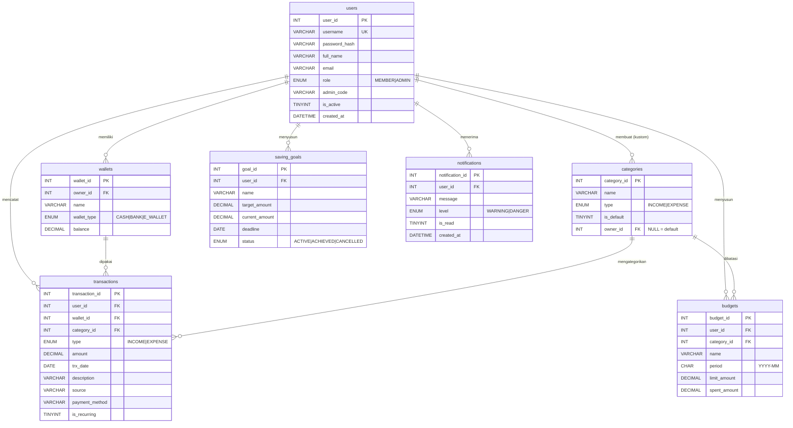

# Rancangan Basis Data SpendWise

- DBMS: **MySQL 8.0.16+** atau **MariaDB 10.6+** (keduanya menegakkan `CHECK` constraint)
- Database: `spendwise` · charset `utf8mb4` · collation `utf8mb4_unicode_ci` · engine InnoDB
- File: `database/schema.sql` (struktur) dan `database/seed.sql` (data awal + contoh)

> Kedua file sudah diuji: `schema.sql` lalu `seed.sql` berhasil di-import ke MariaDB 10.11 tanpa error. Saldo dompet dan `spent_amount` anggaran di seed konsisten dengan data transaksinya.

---

## 1. ERD



---

## 2. Pemetaan Tabel ↔ Kelas

| Tabel | Kelas | Pola | DAO | PJ |
|---|---|---|---|---|
| `users` | `User` → `Member`, `Admin` | *Single-table inheritance*, kolom `role` | `UserDAO` | A1 |
| `wallets` | `Wallet` | — | `WalletDAO` | A1 |
| `categories` | `Category` | `owner_id NULL` = default | `CategoryDAO` | A2 |
| `transactions` | `Transaction` → `Income`, `Expense` | *Single-table inheritance*, kolom `type` | `TransactionDAO` | A2 |
| `budgets` | `FinancialPlan` → `Budget` | `limit_amount` ↔ `targetAmount`, `budget_id` ↔ `planId` | `BudgetDAO` | A3 |
| `saving_goals` | `FinancialPlan` → `SavingGoal` | `target_amount` ↔ `targetAmount`, `goal_id` ↔ `planId` | `SavingGoalDAO` | A3 |
| `notifications` | `Notification` | — | `NotificationDAO` | A3 |

Laporan (`Report`, `CategoryReport`, `PeriodReport`, `DashboardSummary`) **tidak punya tabel** — dihitung dari `transactions`, `wallets`, `budgets`, dan `saving_goals` saat diminta.

---

## 3. Kamus Data

### `users`
| Kolom | Tipe | Null | Keterangan |
|---|---|---|---|
| user_id | INT AI | — | PK |
| username | VARCHAR(30) | — | UNIQUE; 4–30 karakter `[A-Za-z0-9_]` |
| password_hash | VARCHAR(100) | — | `salt$sha256hex` (PRD §5.1) |
| full_name | VARCHAR(100) | — | |
| email | VARCHAR(100) | — | |
| role | ENUM('MEMBER','ADMIN') | — | default MEMBER |
| admin_code | VARCHAR(20) | ✓ | hanya ADMIN (`Admin.adminCode`) |
| is_active | TINYINT(1) | — | 1 aktif, 0 nonaktif |
| created_at | DATETIME | — | default sekarang |

### `wallets`
| Kolom | Tipe | Null | Keterangan |
|---|---|---|---|
| wallet_id | INT AI | — | PK |
| owner_id | INT | — | FK → users, **ON DELETE CASCADE** |
| name | VARCHAR(50) | — | UNIQUE per owner |
| wallet_type | ENUM | — | CASH, BANK, E_WALLET |
| balance | DECIMAL(15,2) | — | `CHECK (balance >= 0)` |

### `categories`
| Kolom | Tipe | Null | Keterangan |
|---|---|---|---|
| category_id | INT AI | — | PK |
| name | VARCHAR(40) | — | keunikan per (owner, type) dicek di service |
| type | ENUM | — | INCOME, EXPENSE |
| is_default | TINYINT(1) | — | `CHECK`: default ⇔ owner_id NULL |
| owner_id | INT | ✓ | FK → users (CASCADE); NULL untuk default |

### `transactions`
| Kolom | Tipe | Null | Keterangan |
|---|---|---|---|
| transaction_id | INT AI | — | PK |
| user_id | INT | — | FK → users (CASCADE) |
| wallet_id | INT | — | FK → wallets (**RESTRICT**: dompet bertransaksi tak bisa dihapus) |
| category_id | INT | — | FK → categories (**RESTRICT**) |
| type | ENUM | — | INCOME → `Income`, EXPENSE → `Expense` |
| amount | DECIMAL(15,2) | — | `CHECK (amount > 0 AND amount <= 1000000000)` |
| trx_date | DATE | — | ≤ hari ini (dicek di `validate()`) |
| description | VARCHAR(255) | ✓ | |
| source | VARCHAR(100) | ✓ | hanya INCOME (`Income.source`) |
| payment_method | VARCHAR(30) | ✓ | hanya EXPENSE (`Expense.paymentMethod`) |
| is_recurring | TINYINT(1) | — | hanya EXPENSE |

Index: `(user_id, trx_date)` untuk riwayat & laporan, `category_id`, `wallet_id`.

### `budgets`
| Kolom | Tipe | Null | Keterangan |
|---|---|---|---|
| budget_id | INT AI | — | PK (`planId`) |
| user_id | INT | — | FK → users (CASCADE) |
| category_id | INT | — | FK → categories (RESTRICT); harus kategori EXPENSE (dicek di service) |
| name | VARCHAR(100) | — | otomatis `"Anggaran <kategori>"` |
| period | CHAR(7) | — | `YYYY-MM` |
| limit_amount | DECIMAL(15,2) | — | `> 0` |
| spent_amount | DECIMAL(15,2) | — | `>= 0`; disinkronkan oleh `BudgetService` |

UNIQUE `(user_id, category_id, period)` → satu anggaran per kategori per bulan.

### `saving_goals`
| Kolom | Tipe | Null | Keterangan |
|---|---|---|---|
| goal_id | INT AI | — | PK (`planId`) |
| user_id | INT | — | FK → users (CASCADE) |
| name | VARCHAR(100) | — | |
| target_amount | DECIMAL(15,2) | — | `> 0` |
| current_amount | DECIMAL(15,2) | — | `>= 0` |
| deadline | DATE | — | |
| status | ENUM | — | ACTIVE, ACHIEVED, CANCELLED |

### `notifications`
| Kolom | Tipe | Null | Keterangan |
|---|---|---|---|
| notification_id | INT AI | — | PK |
| user_id | INT | — | FK → users (CASCADE) |
| message | VARCHAR(255) | — | teks siap tampil |
| level | ENUM | — | WARNING (≥80%), DANGER (≥100%) |
| is_read | TINYINT(1) | — | |
| created_at | DATETIME | — | |

---

## 4. Isi `seed.sql`

| Data | Isi |
|---|---|
| Akun | `admin`/`admin12345` (ADMIN), `budi`/`member12345` (MEMBER berisi data), `sari`/`member12345` (MEMBER kosong, punya dompet "Tunai") |
| Kategori default | Pemasukan: Gaji, Uang Saku, Bonus, Investasi, Pemasukan Lain · Pengeluaran: Makan & Minum, Transportasi, Belanja, Tagihan & Utilitas, Pendidikan, Hiburan, Kesehatan, Kos & Sewa, Pengeluaran Lain |
| Kategori kustom budi | Ngopi (EXPENSE), Freelance (INCOME) |
| Dompet budi | Tunai Rp 150.000 · BCA Rp 990.000 · GoPay Rp 193.000 |
| Transaksi budi | 33 transaksi, 1 Sep – 28 Okt 2026 |
| Anggaran Okt 2026 | Makan & Minum 84,6% (WARNING) · Transportasi 65% · Ngopi 108,5% (EXCEEDED) · Hiburan 50% |
| Target tabungan | Laptop Baru Rp 2,5 jt / 8 jt (ACTIVE, tenggat 30 Jun 2027) · Dana Darurat Rp 3 jt / 3 jt (ACHIEVED) |
| Notifikasi | 3 notifikasi sesuai ambang (1 sudah dibaca) |

Data contoh ini cocok untuk screenshot laporan: semua status anggaran (aman, peringatan, terlampaui) dan semua status target muncul.

`AUTO_INCREMENT` di-reset ke 100/1000 di akhir seed, sehingga data baru tidak bentrok dengan ID contoh.

---

## 5. Query Penting (referensi untuk DAO)

```sql
-- Kategori yang tersedia untuk member (default + milik sendiri) — CategoryDAO.findAvailable
SELECT * FROM categories
WHERE (is_default = 1 OR owner_id = ?) AND type = ?
ORDER BY is_default DESC, name;

-- Riwayat dengan filter — TransactionDAO.findByFilter (klausa opsional ditambahkan bila filter diisi)
SELECT t.*, c.name AS category_name, c.type AS category_type, c.is_default, c.owner_id,
       w.name AS wallet_name, w.wallet_type, w.balance, w.owner_id AS wallet_owner
FROM transactions t
JOIN categories c ON c.category_id = t.category_id
JOIN wallets w    ON w.wallet_id   = t.wallet_id
WHERE t.user_id = ? AND t.trx_date BETWEEN ? AND ?
  /* AND t.type = ? */ /* AND t.category_id = ? */ /* AND t.wallet_id = ? */ /* AND t.description LIKE ? */
ORDER BY t.trx_date DESC, t.transaction_id DESC
LIMIT ? OFFSET ?;

-- Total pengeluaran satu kategori dalam sebulan — TransactionDAO.sumExpense
SELECT COALESCE(SUM(amount), 0) FROM transactions
WHERE user_id = ? AND category_id = ? AND type = 'EXPENSE'
  AND trx_date >= ? AND trx_date < ?;          -- awal bulan, awal bulan berikutnya

-- Cek dipakai — CategoryDAO.isUsed
SELECT EXISTS(SELECT 1 FROM transactions WHERE category_id = ?)
    OR EXISTS(SELECT 1 FROM budgets WHERE category_id = ?);

-- Dompet utama (BR-14)
SELECT * FROM wallets WHERE owner_id = ? ORDER BY wallet_id LIMIT 1;
```

Untuk `LIKE`, bungkus nilai di Java: `"%" + q + "%"` lalu kirim sebagai parameter `?` (bukan disisipkan ke string SQL).

---

## 6. Export untuk Pengumpulan

Sebelum mengumpulkan, export database **terbaru** (termasuk data hasil uji coba yang bagus untuk demo):

```bash
mysqldump -u root -p --databases spendwise --routines --add-drop-database > database/spendwise_export.sql
```

Lalu uji: buat database kosong di komputer lain/XAMPP lain dan import file tersebut. Harus berhasil tanpa error (syarat pengumpulan).
